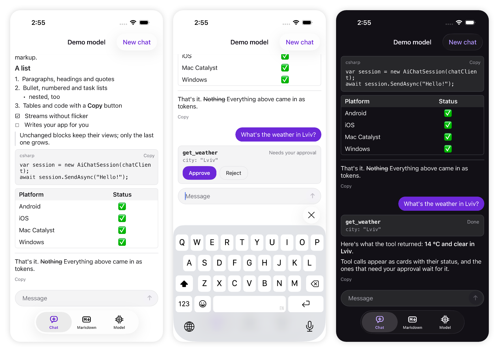

# Plugin.Maui.AiChat

[](https://www.nuget.org/packages/Plugin.Maui.AiChat)
[](https://github.com/MykhailoDav/Plugin.Maui.AiChat/actions/workflows/ci.yml)
[](https://github.com/MykhailoDav/Plugin.Maui.AiChat/blob/main/LICENSE)

An AI chat for .NET MAUI in one view. Give it any `IChatClient` from
[Microsoft.Extensions.AI](https://learn.microsoft.com/dotnet/ai/microsoft-extensions-ai) (OpenAI, Claude, Gemini,
Azure OpenAI, Ollama, Apple Intelligence and many more) and it streams the answers as Markdown that does not flicker, shows tool calls and asks the user before
the ones that need approval, and keeps a history you can save. It runs on Android, iOS, Mac Catalyst and Windows, in pure
managed code, with no setup call and no framework to adopt.



> **Before 1.0.** The API can still change between minor versions until 1.0.

## Features

- **Any model.** Everything goes through `IChatClient`, so the provider is one line of your code and can change without
  touching the UI.
- **Streaming Markdown without flicker.** Unfinished `**bold**`, `` `code` `` and `[links](…)` render as if they were
  closed while the tokens arrive, and only the part of the answer that changed is rebuilt. Headings, lists, task lists,
  quotes, tables, code blocks with a Copy button, and links.
- **Tool calls and approval.** Each call shows as a card with its arguments and status. Calls of an
  `ApprovalRequiredAIFunction` wait for **Approve** or **Reject**, through the standard `FunctionInvokingChatClient`.
- **Reasoning** from models that send it shows as a collapsed *Thinking* section.
- **Stop, Retry and Copy.** Send turns into Stop while an answer streams. A failed answer shows its error with Retry,
  which runs the same request again. Every answer has Copy.
- **A history you own.** `AiChatSession.Messages` is the standard `ChatMessage` list: save it with `AIJsonUtilities` and
  `Load` it back, approvals that were waiting included. Services that keep the conversation themselves (a
  `ConversationId`) get only the new messages.
- **Made for phones.** The list shrinks above the keyboard instead of the page sliding up, follows the end of a streaming
  answer, and stops following when the user scrolls up to read.
- **Light and dark** themes built in, with one accent color to match your app.
- **`MarkdownView` on its own**, for any text that streams in.
- **Light.** No native binaries, no setup call, and dependencies only on .NET MAUI, `Microsoft.Extensions.AI.Abstractions`
  and Markdig. The library is compatible with trimming and Native AOT.

## Installation

```bash
dotnet add package Plugin.Maui.AiChat
```

There is nothing to register in `MauiProgram.cs`. The package needs .NET 10 with .NET MAUI 10, and supports these
platform versions:

| Platform | Minimum version |
| --- | --- |
| Android | 5.0 (API 21) |
| iOS | 15 |
| Mac Catalyst | 15 |
| Windows | 10 version 1809 (10.0.17763) |

## Quick start

The conversation lives in an `AiChatSession` in your view model, so it survives navigation. Any `IChatClient` works;
this one is OpenAI's, from the `Microsoft.Extensions.AI.OpenAI` package:

```csharp
using Microsoft.Extensions.AI;
using OpenAI;
using Plugin.Maui.AiChat;

public sealed class ChatViewModel
{
    public ChatViewModel(string apiKey)
    {
        IChatClient client = new OpenAIClient(apiKey).GetChatClient("gpt-5-mini").AsIChatClient();
        Chat = new AiChatSession(client)
        {
            Options = new ChatOptions { Instructions = "You are a helpful assistant. Answer in Markdown." },
        };
    }

    public AiChatSession Chat { get; }
}
```

```xml
<ContentPage xmlns="http://schemas.microsoft.com/dotnet/2021/maui"
             xmlns:x="http://schemas.microsoft.com/winfx/2009/xaml"
             xmlns:chat="clr-namespace:Plugin.Maui.AiChat;assembly=Plugin.Maui.AiChat"
             x:Class="MyApp.ChatPage">

  <chat:AiChatView Session="{Binding Chat}" />

</ContentPage>
```

That is the whole chat: messages, streaming, Stop, Retry, Copy, and the message field.

> **Keep API keys out of shipped apps.** A key inside an app can be read out of it. The sample connects with a key you
> type in, which is fine for trying things; for an app you ship, call the model through your own server, or use a
> provider that gives each user a short-lived token.

### Other models

Each of these packages gives you an `IChatClient`; pass it to `AiChatSession` the same way.

| Model | Package | Client |
| --- | --- | --- |
| Claude | [Anthropic](https://www.nuget.org/packages/Anthropic) | `new AnthropicClient { ApiKey = apiKey }.AsIChatClient("claude-sonnet-5-5")` |
| Gemini | [Google.GenAI](https://www.nuget.org/packages/Google.GenAI) | `new Client(apiKey: apiKey).AsIChatClient("gemini-3.6-flash")` |
| Ollama, on your machine | [OllamaSharp](https://www.nuget.org/packages/OllamaSharp) | `new OllamaApiClient(new Uri("http://localhost:11434"), "llama3.2")` |
| Apple Intelligence, on the device | [Microsoft.Maui.Essentials.AI](https://www.nuget.org/packages/Microsoft.Maui.Essentials.AI) (preview) | `new AppleIntelligenceChatClient()` on iOS and Mac Catalyst 26 and later |
| Azure OpenAI, OpenRouter, Groq, DeepSeek, LM Studio and other OpenAI-compatible APIs | [Microsoft.Extensions.AI.OpenAI](https://www.nuget.org/packages/Microsoft.Extensions.AI.OpenAI) | `OpenAIClient` with the service's endpoint, below |

```csharp
IChatClient client = new OpenAIClient(
        new ApiKeyCredential(apiKey),
        new OpenAIClientOptions { Endpoint = new Uri("https://openrouter.ai/api/v1") })
    .GetChatClient("openai/gpt-5-mini")
    .AsIChatClient();
```

Apple Intelligence runs on the device with no key, but only where the device supports it: check
`OperatingSystem.IsIOSVersionAtLeast(26)` (or `IsMacCatalystVersionAtLeast(26)`) first and fall back to another model.

Tool calls need a model that supports them. *Thinking* shows only for clients that send the model's reasoning as
`TextReasoningContent`; with the others the answer shows as usual.

From the Android emulator, the development machine is `http://10.0.2.2:11434`. Plain HTTP needs
`android:usesCleartextTraffic="true"` on Android and `NSAllowsLocalNetworking` on iOS; the sample app shows both.

## Tools and approval

Put `FunctionInvokingChatClient` in the client's pipeline and the tools in the options. A tool wrapped in
`ApprovalRequiredAIFunction` waits for the user:

```csharp
IChatClient client = new OpenAIClient(apiKey).GetChatClient("gpt-5-mini").AsIChatClient()
    .AsBuilder()
    .UseFunctionInvocation()
    .Build();

var chat = new AiChatSession(client)
{
    Options = new ChatOptions
    {
        Tools =
        [
            AIFunctionFactory.Create(() => DateTimeOffset.Now, "get_time", "Gets the local date and time."),
            new ApprovalRequiredAIFunction(
                AIFunctionFactory.Create((string path) => DeleteFile(path), "delete_file", "Deletes a file.")),
        ],
    },
};
```

- `get_time` runs as soon as the model asks, and its card shows **Running…** and then **Done**.
- `delete_file` shows its arguments with **Approve** and **Reject**. The answer continues once the user answers every
  request of that response; Reject tells the model the call was not made.
- Sending a new message instead of answering rejects the waiting requests.
- A tool that throws shows **Failed**, and the model gets the error to work with.

## Saving the conversation

`Messages` holds everything, tool calls, results and approvals included. Save it after every answer and load it at the
start:

```csharp
var typeInfo = AIJsonUtilities.DefaultOptions.GetTypeInfo(typeof(IList<ChatMessage>));

chat.ResponseCompleted += (_, _) =>
    File.WriteAllText(path, JsonSerializer.Serialize(chat.Messages.ToList(), typeInfo));

if (File.Exists(path))
{
    chat.Load((IList<ChatMessage>)JsonSerializer.Deserialize(File.ReadAllText(path), typeInfo)!);
}
```

`AIJsonUtilities.DefaultOptions` serializes the messages without reflection, so this works in trimmed and AOT apps.

## The session: `AiChatSession`

| Member | What it does |
| --- | --- |
| `AiChatSession(IChatClient)` | Creates a session. Create it on the UI thread. |
| `Options` | The `ChatOptions` of every request: model, `Instructions` (the system prompt), `Tools`, temperature. |
| `Messages` | The history, oldest first. |
| `IsBusy` | Whether an answer is streaming. Raises `PropertyChanged`. |
| `SendAsync(text)` | Sends a message and streams the answer. Returns when the answer ends; it does not throw when the client fails, because the chat shows the error. Throws for empty text or while busy. |
| `Stop()` | Stops the answer. What arrived stays in the history. |
| `Clear()` | Stops the answer and starts a new conversation. |
| `Load(messages)` | Replaces the conversation with saved messages. |
| `ResponseCompleted` | Raised when an answer ends, with the `ChatResponse`, the status (`Completed`, `Stopped`, `Failed`) and the exception of a failure. |

`SendAsync` called from another thread continues on the UI thread.

## The view: `AiChatView`

| Property | Default | What it is |
| --- | --- | --- |
| `Session` | `null` | The conversation to show. Without one, the message field is disabled. |
| `Placeholder` | `"Message"` | The hint in the empty message field. |
| `AccentColor` | `#512BD4` | The user's messages, Send and Approve. White text goes on it. |
| `EmptyView` | `null` | What shows while the conversation is empty, such as a greeting or suggested questions. |

An empty view with suggestions:

```xml
<chat:AiChatView Session="{Binding Chat}" AccentColor="{StaticResource Primary}">
  <chat:AiChatView.EmptyView>
    <VerticalStackLayout Padding="24" Spacing="8" VerticalOptions="Center">
      <Label Text="Ask anything" FontSize="22" HorizontalOptions="Center" />
      <Button Text="What can you do?" Command="{Binding AskCommand}" CommandParameter="What can you do?" />
    </VerticalStackLayout>
  </chat:AiChatView.EmptyView>
</chat:AiChatView>
```

### UI tests

The parts of the view have automation ids, for Appium and other UI tests: `AiChatList`, `AiChatMessageField`,
`AiChatSendButton`, and in the rows `AiChatUserMessage`, `AiChatAnswer`, `AiChatCopyAnswer`, `AiChatCopyCode`,
`AiChatReasoning`, `AiChatToolStatus`, `AiChatApprove`, `AiChatReject`, `AiChatError` and `AiChatRetry`.

## Markdown on its own: `MarkdownView`

```xml
<chat:MarkdownView Text="{Binding Answer}" IsStreaming="{Binding IsGenerating}" />
```

| Property | Default | What it is |
| --- | --- | --- |
| `Text` | `null` | The Markdown. |
| `IsStreaming` | `false` | Set it while the text still grows: unfinished markup renders as if closed, and renders are paced for streaming. |
| `TextColor` | theme | Near-black in the light theme, near-white in the dark one. |
| `LinkColor` | theme | Violet, lighter in the dark theme. |
| `FontSize` | `16` | Body text; headings and code scale from it. |

It renders CommonMark with GitHub's pipe tables, strikethrough, task lists and autolinks. Single line breaks show as
line breaks, as in chat apps. Long code lines wrap, and table columns share the width.

**Model output is untrusted**, so the view stays on the safe side: links open only for `http`, `https` and `mailto`;
images are not loaded, their alt text shows instead; HTML shows as text.

## Platform notes

- **The keyboard.** The view keeps the message field above the keyboard with the conversation in view:
  - it adds the keyboard (`SafeAreaRegions.SoftInput`) to the bottom safe area of its page, which in .NET MAUI 10 only a
    page honors;
  - on Android, while the chat is on screen, the window resizes for the keyboard instead of panning, and the app's
    own setting comes back when the chat leaves the screen.

  If you set the page's `SafeAreaEdges` yourself, the view leaves both alone.
- **Styles.** Your app's implicit styles still reach the view's parts: the message field takes your `Editor` font, and
  the Send button your `Button` style's *Disabled* state while there is nothing to send.
- **Windows** is built and covered by the shared unit tests, but has not been checked on a device yet. Please
  [open an issue](https://github.com/MykhailoDav/Plugin.Maui.AiChat/issues) if something does not work there.
- **Text in English.** The view's own texts (Copy, Retry, Approve, Thinking) are English in 0.x.

## Sample app

[samples/Plugin.Maui.AiChat.Sample](https://github.com/MykhailoDav/Plugin.Maui.AiChat/tree/main/samples/Plugin.Maui.AiChat.Sample)
works offline with a demo model that streams canned answers, and with any OpenAI-compatible endpoint you connect:

| Tab | What it shows |
| --- | --- |
| Chat | The chat with suggestions, tools (one needs approval), reasoning, an error with Retry, and a conversation saved between runs |
| Markdown | `MarkdownView` on its own: edit Markdown, or replay it as a stream with and without streaming-safe rendering |
| Model | The demo model, or OpenAI, Ollama and other OpenAI-compatible endpoints, with the key in secure storage |

```bash
dotnet build samples/Plugin.Maui.AiChat.Sample -t:Run -f net10.0-android
```

## For AI coding assistants

The package includes `llms-full.txt`, a complete reference of the API and its behavior.
[llms.txt](https://github.com/MykhailoDav/Plugin.Maui.AiChat/blob/main/llms.txt) points to it and to the rest of the
documentation.

## Contributing

Contributions are welcome. [CONTRIBUTING.md](https://github.com/MykhailoDav/Plugin.Maui.AiChat/blob/main/CONTRIBUTING.md)
explains how to build, test and submit changes, and
[SECURITY.md](https://github.com/MykhailoDav/Plugin.Maui.AiChat/blob/main/SECURITY.md) how to report a vulnerability.

## License

[MIT](https://github.com/MykhailoDav/Plugin.Maui.AiChat/blob/main/LICENSE). Markdown is parsed with
[Markdig](https://github.com/xoofx/markdig) (BSD-2-Clause); see
[THIRD-PARTY-NOTICES.md](https://github.com/MykhailoDav/Plugin.Maui.AiChat/blob/main/THIRD-PARTY-NOTICES.md).
